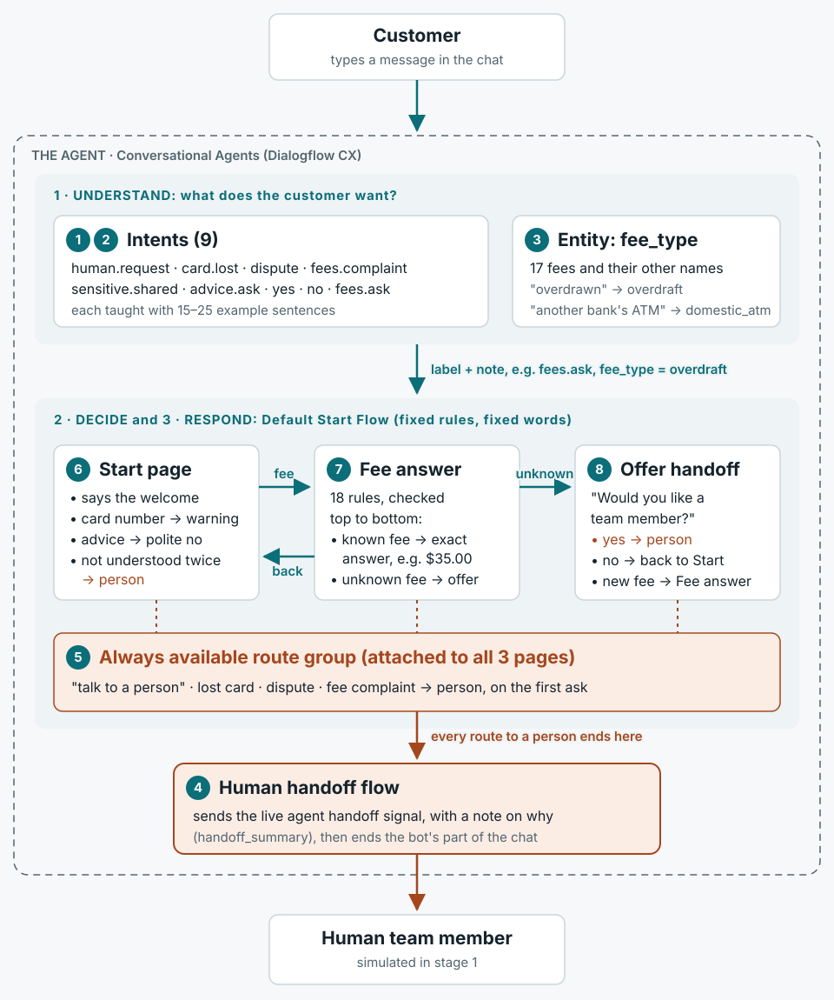

# Harbourline support bot: architecture

*Project 1 · Stage 1 · built Oct 25, 2026*

A rule-based (flow) chat bot built in Google's Conversational Agents console. It understands what the customer wants, follows fixed rules to decide what happens next, and replies with pre-written answers or passes the chat to a person.

## How a message travels through the bot

The numbered circles are the build steps that created each part (see [stage1-build-every-step.md](stage1-build-every-step.md)).

## The bot in three layers

1. **Understand.** Every message is first labelled with an **intent**: what the customer wants. If it's a fee question, the **entity** `fee_type` also notes which fee. This is the only part that uses machine learning, and all it does is label the message.
2. **Decide.** The bot is always on one **page** of the **flow**. Each page has **routes**, which are rules like "if it's a fee question, go to Fee answer". The **route group** adds the four "get a person" rules to every page, so nobody gets trapped.
3. **Respond.** The rule that fires says a fixed, pre-written message. Then it either moves to another page or sends the chat to the **Human handoff flow**, which passes it to a person.

Because the deciding and responding are rules you wrote, the bot always gives the same answer, can't invent a fee, and can't be talked out of its rules.

## The 10 steps on the architecture

| Step | What you built | Layer | What it achieves |
| --- | --- | --- | --- |
| 1 | `human.request` intent | Understand | Recognises "I want a person" in any wording |
| 2 | 7 more intents | Understand | Recognises lost card, dispute, complaint, card numbers, advice, yes and no |
| 3 | `fee_type` entity and `fees.ask` | Understand | Recognises a fee question and which of the 17 fees it's about |
| 4 | Human handoff flow | Respond | One shared exit that passes the chat to a person |
| 5 | Always available route group | Decide | A person on the first ask, from any page |
| 6 | Start page | Decide, respond | Greets, routes fee questions, guards sensitive data, hands off after two misunderstandings |
| 7 | Fee answer page | Decide, respond | Exact answer for each known fee; honest "I don't have that fee" otherwise |
| 8 | Offer handoff page | Decide, respond | Handles yes, no or a new fee question after the offer |
| 9 | Simulator tests | Quality | 11 of 12 passed; fuzzy matching off; unknown-fee examples added |
| 10 | Export | Quality | A saved copy of the whole bot (in [agent/](../agent/)) |

## Follow a message through the layers

**"how much is the overdraft fee"**

1. **Understand:** intent `fees.ask`; the entity finds "overdraft" and notes `fee_type = overdraft`.
2. **Decide:** the Start page rule "fee question → Fee answer" fires.
3. Fee answer checks its 18 rules; "fee_type is overdraft" matches.
4. **Respond:** "Our Overdraft fee is $35.00 per item, up to a maximum of 3 per day…". The note is wiped and the chat returns to Start.

**"can I contact human"**

1. **Understand:** intent `human.request`.
2. **Decide:** whichever page the bot is on, the Always available group has a rule for it.
3. **Respond:** "Of course. I'm connecting you with a team member now." and notes "customer asked for a person".
4. Human handoff flow passes the chat to a person. First ask, no extra questions.

## Four design decisions

- **Rules first, AI later.** Fixed answers can't invent a fee or be prompt-injected, and a flow turn costs $0.007 against $0.012 for AI. In stage 2 an AI version must beat this on the same tests.
- **A person from every page.** The NRMA bot ignored three requests for a human. One route group attached to every page fixes that.
- **Never guess an amount.** Unknown fees get "I don't have that fee". Fuzzy matching is off because it once turned "cheque" into a $30 stop payment answer.
- **Fail toward a human.** Two misunderstandings hand off. "Fee for a cashier's cheque" was misread as a complaint, but the customer still reached a person.

## The pitch, while pointing at the diagram

> "The bot has three layers. At the top, a small language model labels each message with an intent, like 'asking about a fee', and an entity picks out which fee. In the middle, a flow of three pages applies fixed rules and gives pre-written answers, so it can't make up a fee. Underneath every page sits one route group that sends 'talk to a person', a lost card, a dispute or a complaint straight to the handoff flow on the first ask. In stage 2, an AI version has to beat this on the same tests before it talks to customers."
